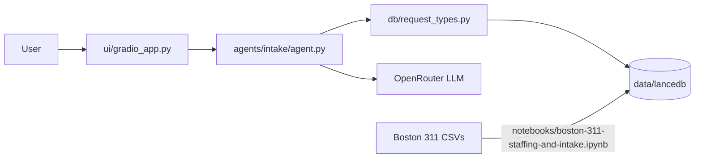
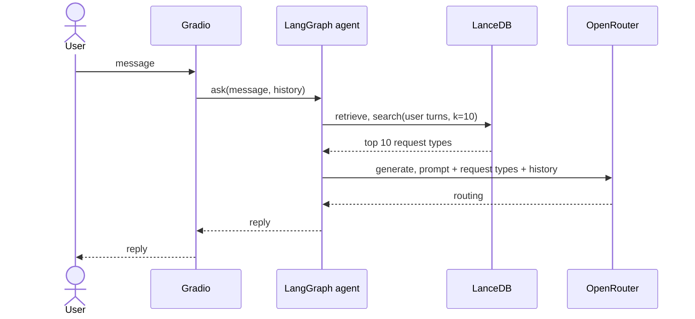

# Boston 311 Intake Assistant

Staffing plan and AI intake assistant for four City of Boston 311 departments.

## Layout

```
.
|-- app.py                  entry point, launches the UI
|-- agents/intake/          LangGraph RAG agent
|-- db/                     LanceDB embedding function and request type search
|-- notebooks/              data ingestion and analysis
|-- scripts/                bootstrap installers
`-- ui/                     Gradio chat app
```

## Architecture



In each chat turn, Gradio passes the visible history to the agent. The agent searches the request types with everything the user has said so far, then asks the LLM to pick the type, department and queue from those results.



## Setup

Run every command from the project root.

**Windows users:** use PowerShell (not Command Prompt or Git Bash) and the `.ps1` scripts. The `-ExecutionPolicy Bypass` flag avoids Windows' default "running scripts is disabled" error.

### 1. Configure

Copy the template to `.env` (gitignored, never commit it) and set `OPENAI_API_KEY` to your [OpenRouter key](https://openrouter.ai/keys). The other values have working defaults.

macOS / Linux:

```bash
[ -f .env ] || cp .env.example .env
```

Windows (PowerShell):

```powershell
if (-not (Test-Path .env)) { Copy-Item .env.example .env }
```

### 2. Install uv and dependencies

Installs [uv](https://docs.astral.sh/uv/) if missing, then the project dependencies and the Python version pinned in `pyproject.toml`. If uv was just installed, open a new terminal afterwards.

macOS / Linux:

```bash
./scripts/bootstrap.sh
```

Windows (PowerShell):

```powershell
powershell -ExecutionPolicy Bypass -File .\scripts\bootstrap.ps1
```

### 3. Build the 311 database

Open `notebooks/boston-311-staffing-and-intake.ipynb`, select the `.venv` kernel and run all cells. It downloads the 2023 and 2024 request files (about 180 MB each) into `data/`, then writes the `requests` and `request_types` tables to `data/lancedb`. The forecast, staffing and sensitivity results go to CSV files in `outputs/`. Later runs reuse the downloaded files.

## Run

macOS / Linux:

```bash
./start.sh
```

Windows (PowerShell):

```powershell
powershell -ExecutionPolicy Bypass -File .\start.ps1
```

Open the URL printed in the terminal (default http://127.0.0.1:7860). Press Ctrl+C to stop.
